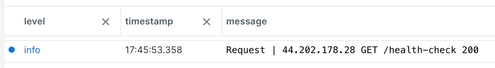
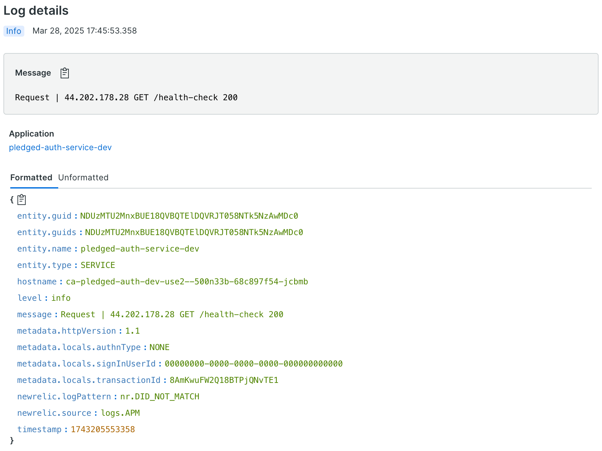

# winston-newrelic-agent-transport


A Winston transport using the New Relic agent. The transport requires your application to be using the New Relic agent.

The transport leverages the agent API to send log messages so it is not necessary to use an http client or set New Relic connection information for the transport. Once your agent is configured and connecting to New Relic, this transport should send logs.

The transport allows you to exclude log messages that match configured characteristics. If there are certain types of log messages you wish to keep out of New Relic, such as health checks, the transport can help with that. See [rejectCriteria](#rejectcriteria-optional) for how to configure the exclusions, and [Agent Log Forwarding](#agent-log-forwarding) for a setting you likely need to change so that the agent does not forward the messages you excluded.

The New Relic agent also forwards Winston logs on its own. When I wrote this transport, that automatic forwarding did not happen in ECMAScript Module applications unless the agent was loaded with its experimental ESM loader, and this transport was a way to get logs to New Relic without using the loader. Recent agent versions handle ECMAScript Modules without it, so you may find the agent is already forwarding your logs. This transport remains useful when you want control over which messages are sent.

## Requirements

Node.js 22 or later.

Version 2.0.0 uses version 14 of the New Relic agent, which dropped support for Node.js 20. If you need to run on an older version of Node.js, version 1.0.11 of this transport uses version 12 of the agent, which supports Node.js 18 or later.

## Installation

```sh
npm install --save winston-newrelic-agent-transport
```

## Usage

```javascript
import { createLogger } from 'winston'
import NewrelicTransport from 'winston-newrelic-agent-transport'

const logger = createLogger({
  transports: [
    new NewrelicTransport({
      level: 'info'
    })
  ]
})

export default logger
```

### Options

#### level (optional)

The Winston logging level to use as the maximum level of messages that the transport will log.

#### rejectCriteria (optional)

The rejectCriteria option allows you to specify an array of regexes that will be matched against either the Winston info object or log message to determine whether or not a log message should be rejected and not logged to New Relic.

If a log message matches any of the regexes, it will be rejected and not logged to New Relic.

Each item in the array is an object with the following fields:

`property`
: The name of the property in the Winston info object whose value should be checked or use `null` to indicate that the log message should be checked.

`regex`
: The regex to match against the value indicated by `property`.

A `property` can use dot notation or bracket notation to reach a nested value, such as `metadata.headers.user-agent` or `metadata.headers['user-agent']`. Use quoted bracket notation when a key contains a dot, as in `metadata['error.message']`, so that the key is not treated as two levels. Only quoting has that effect: an unquoted `metadata[error.message]` is the same as `metadata.error.message`.

Every item in the array is checked. If the `property` for an item is missing from a given log entry, or holds a value that is not a string, that item is skipped and the remaining items are still checked. This matters when a criterion points at a property that only some log entries have, such as a request header.

The regexes are compiled when the transport is constructed. An invalid regex throws at that point, so a mistake in the criteria is reported when your logger is created rather than going unnoticed. If checking the criteria fails at log time for any other reason, the log message is sent to New Relic rather than dropped.

The Winston info object includes the data you added using the logger `meta` parameter. For example, if you added a log entry with commands like the following, fields added to the locals object could be retrieved at `metadata.locals`.

```javascript
  const meta = {
    locals: res.locals,
  }

  logger.info(message, meta)
```

A hosting provider was sending many health checks to our site and we wished to exclude them from the New Relic logs. We used the following rejectCriteria to not log these health checks to New Relic:

```javascript
  new NewrelicTransport({
    level: 'info',
    rejectCriteria: [
      {
        property: 'metadata.headers.user-agent',
        regex: '^ELB-HealthChecker'
      }
    ]
  })
```

## Agent Log Forwarding

The New Relic agent has its own Winston support. When agent log forwarding is enabled, which is the default, the agent adds a transport named `newrelic` to each Winston logger you create and forwards every log entry through it. This happens even when using ECMAScript modules.

That transport does not know about your rejectCriteria, so the entries you meant to exclude are still sent to New Relic. The entries you did not exclude are sent twice, once by each transport. The two copies do not look alike, because the agent sends the Winston log line as it stands while this transport sends what your format chain produced, so the duplication is not always obvious.

You can see whether the agent added its transport by listing the transports on your logger:

```javascript
console.log(logger.transports.map((transport) => transport.name))
// [ 'console', 'winston-newrelic-agent-transport', 'newrelic' ]
```

To leave log forwarding to this transport, turn off the agent Winston instrumentation in your New Relic config:

```javascript
exports.config = {
  instrumentation: {
    winston: {
      enabled: false
    }
  }
}
```

Do not use `application_logging.forwarding.enabled` for this. That flag also gates the agent `recordLogEvent` method this transport calls, so turning it off stops this transport from sending anything to New Relic.

## Notes

I found that since this transport is using the agent recordLogEvent method to log events, the agent adds the New Relic context to the log. It is not necessary to add `application_logging.local_decorating.enabled: true` to your New Relic config. Adding that entry did not change the context behavior at all. It is also not necessary to use `@newrelic/winston-enricher`.

To get the metadata information showing at New Relic, I found it is important to put the log entry in JSON format.

A caution is that New Relic starts to show the entry JSON instead of the message if the log entry is too large. When this happens, the entry is also not parsed into its separate fields. The following example shows how to pick the exact fields to send to New Relic to reduce the size of the entry. If I include all of my metadata, the log entry is too large for New Relic. So, I only include a few selected properties like the locals object. The locals object is used to record fields like user id that are useful to query against.

The transport code uses the [JavaScript Standard Style](https://standardjs.com) and may be checked with `npm run lint`.

## Logging Example

### Winston Logger

Here is an example of Winston logger code using this transport:

```javascript
import { jsonc } from 'jsonc'
import { format } from 'logform'
import winston from 'winston'
import NewrelicTransport from 'winston-newrelic-agent-transport'

import config from '../config.js'

const LOG_LEVEL_DEBUG = 'debug'
const LOG_LEVEL_INFO = 'info'

// New Relic does not like log entries that are too large. Thus, keep fields to a minimum.
const newrelicFormat = format((info) => {
  const nrFormat: {
    level: string
    timestamp: string
    message: string
    metadata: {
      locals?: object
      httpVersion?: string
    }
  } = {
    level: info.level,
    timestamp: typeof info.timestamp === 'string' ? info.timestamp : '',
    message: typeof info.message === 'string' ? info.message : '',
    metadata: {}
  }

  if ('metadata' in info && typeof info.metadata === 'object' && info.metadata !== null) {
    if ('locals' in info.metadata && typeof info.metadata.locals === 'object' && info.metadata.locals !== null) {
      nrFormat.metadata.locals = info.metadata.locals
    }
    if ('httpVersion' in info.metadata && typeof info.metadata.httpVersion === 'string') {
      nrFormat.metadata.httpVersion = info.metadata.httpVersion
    }
  }

  return nrFormat
})()

let options: winston.LoggerOptions
if (config.get('runningLocal')) {
  options = {
    transports: [
      new winston.transports.Console({
        level: LOG_LEVEL_DEBUG,
        format: format.combine(
          format.timestamp({ format: 'YYYY-MM-DD HH:mm:ss.SSS' }),
          format.metadata({ key: 'metadata', fillExcept: ['level', 'message', 'timestamp'] }),
          format.align(),
          format.printf((info) => {
            const timestamp = typeof info.timestamp === 'string' ? info.timestamp : ''
            const message = typeof info.message === 'string' ? info.message : ''
            const metadata = info.metadata as object
            return `${timestamp} ${info.level}: ${message}${(Object.entries(metadata).length > 0) ? ' | ' + jsonc.stringify(info.metadata) : ''}`
          })
        )
      })
    ]
  }
} else {
  options = {
    transports: [
      new winston.transports.Console({
        level: LOG_LEVEL_INFO,
        format: format.combine(
          format.timestamp({ format: 'YYYY-MM-DD HH:mm:ss.SSS' }),
          format.metadata({ key: 'metadata', fillExcept: ['level', 'message', 'timestamp'] }),
          format.align(),
          format.printf((info) => {
            const timestamp = typeof info.timestamp === 'string' ? info.timestamp : ''
            const message = typeof info.message === 'string' ? info.message : ''
            const metadata = info.metadata as object
            return `${timestamp} ${info.level}: ${message}${(Object.entries(metadata).length > 0) ? ' | ' + jsonc.stringify(info.metadata) : ''}`
          })
        )
      }),
      new NewrelicTransport({
        level: LOG_LEVEL_INFO,
        rejectCriteria: [
          {
            property: 'metadata.headers.user-agent',
            regex: '^ELB-HealthChecker'
          }
        ],
        format: format.combine(
          format.timestamp(),
          format.metadata({ key: 'metadata', fillExcept: ['level', 'message', 'timestamp'] }),
          newrelicFormat,
          format.json()
        )
      })
    ]
  }
}

const logger = winston.createLogger(options)

export default logger
```

### Express Logging Middleware

Here is an example of [Express](https://expressjs.com/) logging middleware using the above logger:

```javascript
// Log requests.
const log = (req: Request, res: Response): void => {
  const ipAddress = req.headers['x-forwarded-for'] as string ?? req.ip
  const message = `Request | ${ipAddress} ${req.method} ${req.originalUrl} ${res.statusCode}`

  // Do not show bearer token.
  if ((req.headers.authorization !== undefined) && (req.headers.authorization.startsWith('Bearer'))) {
    req.headers.authorization = 'Bearer [REDACTED]'
  }

  const meta = {
    locals: res.locals,
    headers: req.headers,
    httpVersion: req.httpVersion
  }

  switch (res.statusCode.toString().charAt(0)) {
    case '4':
      logger.warn(message, meta)
      break
    case '5':
      logger.error(message, meta)
      break
    default:
      logger.info(message, meta)
  }
}
app.use((req: Request, res: Response, next: NextFunction) => {
  onFinished(res, (_err, res: Response) => {
    log(req, res)
  })
  next()
})
```

The code is using [on-finished](https://www.npmjs.com/package/on-finished) to allow logging after the response has been sent. This allows access to the full range of response information.

### New Relic Output

The above code produces a lean log entry in the New Relic Logs list that looks like this:
</br>
</br>


Clicking on the log entry displays Log details that look like this:
</br>
</br>


The Log details include the custom fields added to the locals object. Notable is those custom fields can be used in NRQL queries.
